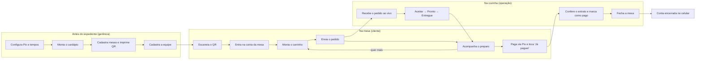
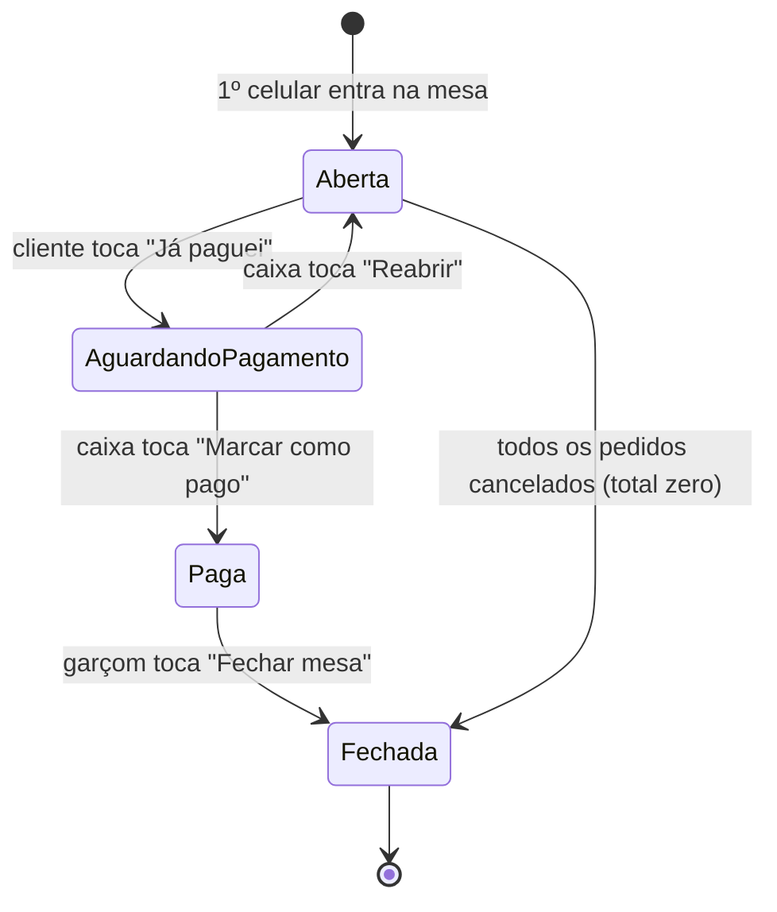
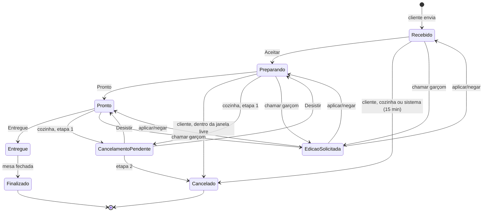

# Jornada do usuário — ponta a ponta

Como cada pessoa usa o sistema, do preparo do estabelecimento até a mesa ser fechada. Complementa o [`PRD.md`](PRD.md) (o que o produto faz) e o [`AGENTS.md`](AGENTS.md) (como é construído). Os códigos entre colchetes, como `[CLI-04]`, apontam para os requisitos do PRD §7.

Validada com testes de usabilidade em 2026-11-10 (cliente no celular, equipe no computador). Os pontos de atrito encontrados estão na [seção 6](#6-pontos-de-atrito-conhecidos).

---

## Índice

1. [Personagens](#1-personagens)
2. [Visão geral](#2-visão-geral)
3. [Jornada do cliente](#3-jornada-do-cliente)
4. [Jornada da equipe (operação)](#4-jornada-da-equipe-operação)
5. [Jornada da gerência](#5-jornada-da-gerência)
6. [Pontos de atrito conhecidos](#6-pontos-de-atrito-conhecidos)
7. [Estados por trás da jornada](#7-estados-por-trás-da-jornada)

---

## 1. Personagens

| Quem | Aparelho | Entra como | Telas |
|---|---|---|---|
| **Cliente** | Celular próprio | Anônimo (nenhum login visível), nome opcional | `/mesa/:numero` → Cardápio, Minha conta, Pagar |
| **Operação** (cozinha, garçom, caixa) | Tablet da cozinha | Matrícula + PIN de 6 dígitos | `/cozinha` (Pedidos) e `/cozinha/contas` (Contas) |
| **Gerência** | Computador ou tablet | Matrícula + PIN, papel `gerencia` | Tudo da operação + `/gerencia/*` (Cardápio, Mesas, Equipe, Auditoria, Configurações) |

---

## 2. Visão geral

**Fases, em ordem:**

| # | Fase | Quem age | Termina quando |
|---|---|---|---|
| 0 | Preparação | Gerência | Cardápio, mesas com QR, Pix e equipe prontos |
| 1 | Chegada | Cliente | Está dentro da conta da mesa vendo o cardápio |
| 2 | Pedido | Cliente | Pedido enviado (estado *Recebido*) |
| 3 | Preparo | Operação | Pedido *Entregue* na mesa |
| 4 | Ajustes (opcional) | Cliente / operação | Pedido editado, cancelado ou de volta ao estado anterior |
| 5 | Novas rodadas (opcional) | Cliente | Volta à fase 2 quantas vezes quiser |
| 6 | Pagamento | Cliente → caixa | Conta *Paga* |
| 7 | Fechamento | Garçom | Conta *Fechada*; o celular perde o acesso |

---

## 3. Jornada do cliente

### Fase 1 — Chegada

| Passo | O cliente faz | O sistema faz | Tela |
|---|---|---|---|
| 1.1 | Aponta a câmera para o QR da mesa | Abre `/mesa/1` no navegador | — |
| 1.2 | — | Faz login anônimo em segundo plano e confere se a mesa existe e está ativa `[CLI-01]` | Carregando |
| 1.3 | Vê "Bem-vindo!" e, se quiser, digita o nome | Guarda o nome para a cozinha `[CLI-07]` | Boas-vindas |
| 1.4 | Toca **"Ver o cardápio"** | Entra na conta aberta da mesa ou cria uma nova; todos os celulares da mesa compartilham a mesma conta `[CLI-02]` | Cardápio |

**Exceções:**
- Mesa inexistente ou desativada → tela **"Mesa indisponível — chame um atendente"**.
- Dois celulares abrem a mesa no mesmo instante → um deles cria a conta e o outro entra nela automaticamente.
- Celular que já esteve na mesa → pula a tela de boas-vindas e volta direto para a conta.

### Fase 2 — Pedido

| Passo | O cliente faz | O sistema faz | Tela |
|---|---|---|---|
| 2.1 | Navega pelas categorias (botões no topo levam à seção) | Mostra só itens ativos e disponíveis, na ordem da gerência `[CLI-03]` | Cardápio |
| 2.2 | Toca **"Adicionar"**; ajusta com **− / +** | Carrinho local, só no celular, sem gravar nada `[CLI-04]` | Cardápio |
| 2.3 | Vê a barra **"Ver pedido (n) · R$ total"** no rodapé | Soma em tempo real | Cardápio |
| 2.4 | Toca a barra e revisa | Abre a gaveta "Seu pedido" | Gaveta |
| 2.5 | Toca **"Enviar para a cozinha"** | Cria o pedido em *Recebido*, congelando nome e preço de cada item | Minha conta |
| 2.6 | Vê "Pedido #N enviado para a cozinha" | O pedido aparece na cozinha na hora | Minha conta |

**Observação para a cozinha** ("sem cebola", "carne ao ponto"): é uma só por conta, em *Minha conta* → **"Salvar observação"** `[CLI-06]`.

### Fase 3 — Acompanhamento

| O cliente vê | Significa |
|---|---|
| **Recebido** | A cozinha ainda não aceitou |
| **Preparando** | A cozinha aceitou e está fazendo |
| **Pronto** | Saindo da cozinha |
| **Entregue** | Chegou à mesa |
| **Cancelado** (itens riscados) | Saiu da conta |

Os estados mudam sozinhos, sem recarregar a página `[CLI-05]`. O **"Total da mesa"** soma só o que não foi cancelado nem removido.

### Fase 4 — Ajustes

| Situação | O cliente vê | O que acontece |
|---|---|---|
| Pedido em *Recebido* | **Editar** e **Cancelar pedido** | Muda quantidades, remove itens (ficam riscados) ou cancela, sem aprovação `[CLI-08]` |
| *Preparando* há menos de 2 min (configurável) | Os mesmos botões + **"Dá para mudar por mais 1:56"** | Igual ao anterior, dentro da janela livre |
| *Preparando* após a janela, ou *Pronto* | **"Chamar garçom para mudar"** | O pedido vai para *Edição solicitada* e a cozinha decide `[CLI-09]` |
| *Entregue* | Nenhum botão | Não dá mais para mudar |

**Automático:** um pedido que fica em *Recebido* mais de 15 min (configurável) é cancelado pelo sistema. Isso só acontece com o tablet da cozinha aberto.

### Fase 5 — Novas rodadas

O cliente volta ao **Cardápio** e repete a fase 2. Cada envio vira um novo pedido (#13, #14…) na **mesma conta**.

### Fase 6 — Pagamento

| Passo | O cliente faz | O sistema faz | Tela |
|---|---|---|---|
| 6.1 | Toca a aba **"Pagar"** | Mostra o total, o **QR Code Pix** e o **Pix copia e cola** com o valor exato `[CLI-10]` | Pagar |
| 6.2 | Lê o QR no app do banco ou toca **"Copiar código"** | — | App do banco |
| 6.3 | Paga no banco e toca **"Já paguei"** → **"Sim, já paguei"** | A conta vai para *Aguardando pagamento* e **bloqueia novos pedidos** `[CLI-11]` | "Aguardando confirmação do caixa" |
| 6.4 | Espera | Quando o caixa confirma, a tela muda sozinha | **"Pagamento confirmado — Obrigado pela visita!"** |

**Exceções:**
- Chave Pix, nome ou cidade não configurados → **"Pagamento indisponível, chame o garçom"**.
- Quer pedir mais depois do "Já paguei" → os botões "Adicionar" ficam desabilitados com o aviso "chame um atendente para reabrir"; o caixa usa **Reabrir**.
- Nada a pagar → "Nada a pagar por enquanto" + botão para o cardápio.

### Fase 7 — Fechamento (fim da jornada)

| Passo | O que acontece | Tela do cliente |
|---|---|---|
| 7.1 | O garçom fecha a mesa | **"Conta encerrada — Esta mesa foi fechada. Obrigado pela visita!"** |
| 7.2 | O celular perde o acesso à conta antiga | — |
| 7.3 | O próximo cliente escaneia o mesmo QR | Começa uma conta nova (volta à fase 1) |

---

## 4. Jornada da equipe (operação)

### Início do turno

1. Abre `/cozinha` no tablet → vai para **"Acesso da equipe"**.
2. Digita **matrícula + PIN** → **Entrar** `[OPE-01]`.
3. Deixa o tablet aberto durante todo o expediente: as rotinas automáticas (auto-cancelamento e mesas inativas) rodam nele.

### Ciclo de cada pedido — aba **Pedidos**

O painel tem 3 colunas (**Novos**, **Preparando**, **Prontos**) e o indicador **"Ao vivo"** `[OPE-02]`. Cada cartão mostra a mesa, o nº do pedido e da conta, os itens, a observação da mesa, o estado e o tempo no estado `[OPE-03]`.

| Pedido em | Botões | Ação |
|---|---|---|
| Recebido | **Aceitar**, **Cancelar** | Aceitar → *Preparando* |
| Preparando | **Pronto**, **Cancelar** | Pronto → *Pronto* |
| Pronto | **Entregue**, **Cancelar** | Entregue → sai do painel |
| Edição solicitada (destacado) | **Aplicar edição**, **Negar** | Volta ao estado de antes `[OPE-05]` |

Só aparecem os botões das transições válidas `[OPE-04]`.

### Cancelamento pela cozinha `[OPE-06]`

| Pedido em | Como funciona |
|---|---|
| Recebido | **1 etapa**: escolher o motivo → **Cancelar pedido** |
| Preparando / Pronto | **Etapa 1**: escolher o motivo (sem ingrediente, erro de pedido, cliente desistiu, atraso, outro) → **Continuar** → fica *Cancelamento pendente*. **Etapa 2**: digitar o nº do pedido OU esperar 2s e tocar **Confirmar cancelamento**; **Desistir** devolve o pedido ao estado anterior |
| Entregue | Não pode ser cancelado |

O motivo é obrigatório: sem ele aparece "Escolha o motivo.", e com "outro" o texto é obrigatório. A regra vale também para a gerência.

### Fim da conta — aba **Contas** `[OPE-07]` `[OPE-08]`

| Seção | Quando a mesa aparece | Ação |
|---|---|---|
| **Aguardando confirmação** | O cliente tocou "Já paguei" | Conferir o extrato → **Marcar como pago**, ou **Reabrir** se o cliente quiser pedir mais |
| **Pagas (fechar mesa)** | Conta paga | **Fechar mesa**: só funciona sem pedidos pendentes; os pedidos entregues viram *Finalizado* |
| **Abertas** | Conta em uso | Acompanhar; mesas inativas há muito tempo aparecem destacadas |

---

## 5. Jornada da gerência

A gerência faz tudo da operação e mais a preparação (fase 0) e o acompanhamento.

| Momento | Tela | O que faz |
|---|---|---|
| Implantação | **Configurações** | Chave Pix, nome (≤ 25 caracteres), cidade (≤ 15), telefone, janela de edição, tempo de auto-cancelamento e de mesa inativa `[GER-06]` |
| Implantação | **Cardápio** | Cria categorias (↑↓ ou arrastar para ordenar) e itens com nome, preço, categoria e foto `[GER-01]` `[GER-02]` |
| Implantação | **Mesas** | Cadastra mesas e usa **Imprimir QR Codes** `[GER-04]` |
| Implantação | **Equipe** | Cria funcionários (matrícula, nome, papel, PIN) `[GER-05]` |
| Dia a dia | **Cardápio** | **Marcar esgotado** (some do cliente na hora), editar preço (pedidos já feitos não mudam `[GER-03]`), **Excluir** (desativa, não apaga) |
| Dia a dia | **Equipe** | **Trocar PIN**, **Desativar** quem saiu |
| Conferência | **Auditoria** | Filtra por período, tipo e ator; **Exportar CSV** para o Excel `[GER-07]` `[GER-08]` |

---

## 6. Pontos de atrito conhecidos

Encontrados nos testes de usabilidade de 2026-11-10. Nenhum impede o fluxo, exceto o primeiro, que impede o uso real.

| # | Fase | Atrito | Impacto |
|---|---|---|---|
| 1 | 0 | QR das mesas impresso a partir de `localhost` aponta para `http://localhost:5173/...` (`src/pages/gerencia/MesasPage.tsx:9`) | **Alto**: o celular do cliente não abre. Imprimir só pelo endereço publicado |
| 2 | 3–4 | Pedido cancelado aparece só como "Cancelado", sem motivo (auto-cancelamento ou cozinha) | Médio: o cliente não sabe o que houve |
| 3 | 2–7 | O aviso "Pedido #N enviado" fica em todas as abas, mesmo depois de cancelado ou pago | Baixo: mensagem contraditória |
| 4 | Contas | "Marcar como pago" e "Fechar mesa" agem num toque, sem confirmação nem desfazer | Médio: toque errado fecha a mesa errada |
| 5 | 0 | Formulário de item mostra um erro por vez, no rodapé, sem marcar o campo | Baixo |
| 6 | Auditoria | Textos crus ("item cardapio criado", "sem_ingrediente") | Baixo |
| 7 | Pedidos | Ao recarregar, mostra "0 pedido(s)" e "Nada aqui." enquanto carrega | Baixo: parece fila vazia |
| 8 | Contas | "4 pedido(s)" conta também os cancelados | Baixo |
| 9 | Equipe no celular | Menu de abas rola para o lado; Auditoria e Configurações ficam escondidas | Baixo (feito para tablet) |
| 10 | Cardápio (gerência) | Item sem foto aparece como quadrado cinza; no cliente aparece a inicial | Baixo |

**Situação em 2026-11-11:** os atritos 2 a 10 foram corrigidos. Continua valendo o 1: imprima os QR só pelo endereço publicado (`https://cardapio-qr-code-p68a.vercel.app/gerencia/mesas`).

---

## 7. Estados por trás da jornada

Mesma jornada, vista pelos dados. Detalhes em `AGENTS.md` §6.3 e §6.4.

**Conta (comanda):**

**Pedido:**

Os estados temporários (*Edição solicitada*, *Cancelamento pendente*) sempre voltam para o estado exato de onde saíram.
